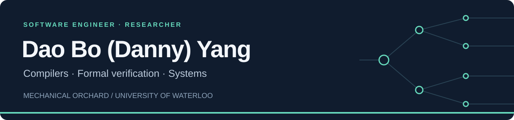
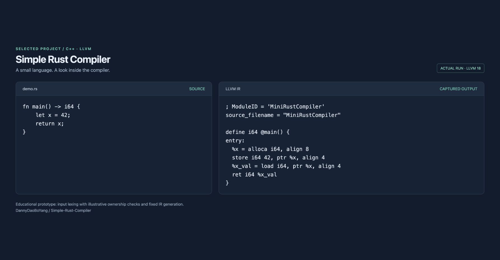

[Website](https://daoboyang-b4132.web.app/) · [LinkedIn](https://www.linkedin.com/in/daoboyang/) · [FMCAD paper](https://doi.org/10.34727/2026/isbn.978-3-85448-093-8_56) · [Research artifact](https://github.com/DannyDaoBoYang/FMCAD2026MoveProverProphecyVariableArtifact)

I'm **Danny (Dao Bo Yang)**, a software engineer at **[Mechanical Orchard](https://github.com/mechanical-orchard)**. I work on compilers and have a research background in formal verification and the Move Prover.

Previously, I completed co-op placements at **Huawei**, **D2L**, **Uplift**, **Cannon Medical**, and **Caribou Contest**. I studied Computer Science at the **University of Waterloo** (BCS 2024; MMath 2026).

## Publications

**[Prophecy Variables and Invariants in the Move Prover](https://doi.org/10.34727/2026/isbn.978-3-85448-093-8_56)** 
**Dao Bo Yang**, Arie Gurfinkel, and Richard Trefler. 
FMCAD 2026 · Main-track paper · pp. 527–536.

[Paper](https://repositum.tuwien.at/handle/20.500.12708/230521) · [Code and experiments](https://github.com/DannyDaoBoYang/FMCAD2026MoveProverProphecyVariableArtifact)

<strong>Research summary</strong>

This work uses prophecy variables to constrain parent values in the Move Prover, replacing chains of direct write-backs when reasoning about ownership borrows. It also examines how global and update invariants interact with Move's ownership rules. In one conditional-borrow benchmark with a borrow-chain length of 2 and 8 possible parent nodes, verification time fell from 42 seconds to under 2 seconds.

See the [published paper](https://doi.org/10.34727/2026/isbn.978-3-85448-093-8_56) for the model, benchmark conditions, and limitations.

### Student Forum

**[Rethinking Global Invariants in the Move Prover: Lifetime Boundaries and Verification Efficiency](https://fmcad.org/FMCAD26/student_forum/)** 
**Dao Bo Yang**, Arie Gurfinkel, and Richard Trefler. 
FMCAD 2026 · Student Forum report.

## Selected projects

| Project | What you'll find |
| --- | --- |
| **[Simple Rust Compiler](https://github.com/DannyDaoBoYang/Simple-Rust-Compiler)** | A C++ / LLVM toy compiler for a small Rust-like language, with a lexer, illustrative ownership checking, and a fixed LLVM IR example. |
| **[FMCAD 2026 research artifact](https://github.com/DannyDaoBoYang/FMCAD2026MoveProverProphecyVariableArtifact)** | The original and prophecy-variable versions of the Move Prover, with benchmark inputs, experimental logs, and reproduction instructions. |
| **[Move Prover implementation](https://github.com/DannyDaoBoYang/aptos-core/tree/prophecy_fmcad2026)** | My research branch implementing the prophecy-variable model in the Aptos Move Prover. |

<strong>See the toy compiler demo</strong>

Captured from an actual run of the prototype using LLVM 18. The lexer reads the input; ownership analysis and IR generation currently demonstrate fixed examples. This is an educational prototype, not a full Rust compiler.

## Open-source contributions

Selected merged contributions to **[LLVM / Clang](https://github.com/llvm/llvm-project)**:

- **[Clang IR: x86 builtins](https://github.com/llvm/llvm-project/pull/173802)** — Added support for `pmovqd512_mask` and `pmovwb512_mask`, with regression tests.
- **[LLVM libc: constexpr sinpif](https://github.com/llvm/llvm-project/pull/176580)** — Prepared the implementation for compile-time math evaluation.
- **[LLVM libc: header-only sinpif16](https://github.com/llvm/llvm-project/pull/178503)** — Refactored the half-precision implementation into headers.
- **[Clang IR: Windows build fix](https://github.com/llvm/llvm-project/pull/174519)** — Fixed a `std::max` type mismatch on 64-bit Windows.

<strong>Experience</strong>

| Organization | Role |
| --- | --- |
| Mechanical Orchard | Software Engineer · Current |
| Huawei | Co-op |
| D2L | Co-op |
| Uplift | Co-op |
| Cannon Medical | Co-op |
| Caribou Contest | Co-op |

